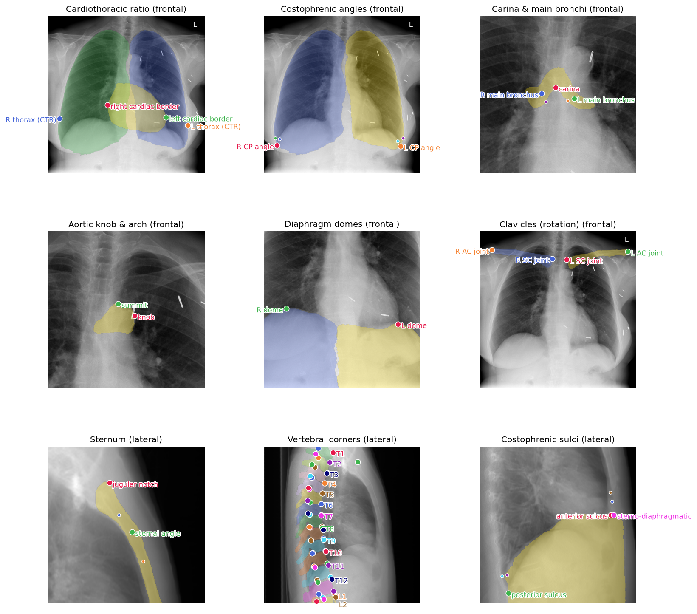

# Semantic landmark detection in chest radiographs

Semantic anatomical landmarks for chest radiographs: a clinically curated landmark vocabulary, the
geometric rules that turn anatomy masks into landmark labels, and a joint mask + landmark model.


*Predictions of the released model, one panel per landmark group (selection): named landmarks
over the predicted masks of the structures they are defined on. Frontal: an unseen
radiograph from NIH ChestX-ray14 (NIH Clinical Center). Lateral: a PAXRay++ test image (CT
projection), as no openly licensed real lateral radiograph was at hand. Small unlabelled points are
the limb points of angles and the remaining vertebral corners. Generated with
`scripts/make_readme_figure.py`.*

Code, definitions and weights for the paper *Semantic landmark detection in chest radiographs*
(Seibold, Havemann, Vinu, Fink), currently under review.

> **Research use only.** The model is not a medical device and must not be used for clinical decisions.

## What is in this repository

| | |
|---|---|
| **Landmark vocabulary** (`src/cxrlandmarks/vocab/`) | 132 landmark definitions on the 177 PAXRay++ structures, curated by two reviewers with a medical background and a board-certified radiologist; 311 view-specific class–landmark pairs (203 frontal, 108 lateral), at most 13 per structure. Human-readable tables: `landmarks.csv` (definitions, rules, review outcome, literature), `groups.csv` (clinical groups), `references.csv` (53 sources). |
| **Landmark rules** (`src/cxrlandmarks/rules/`) | The geometric rules (extreme, contact, ridge/centerline and centroid points on anatomy masks) that produce the silver labels from PAXRay++ masks. This is the exact version used for the paper; regenerating the test and val splits reproduces the paper's label files byte for byte. |
| **Joint dense model** (`src/cxrlandmarks/model.py`) | RAD-DINO ViT-B/14 encoder shared by a landmark-heatmap decoder (one channel per class–landmark pair) and a mask decoder (one channel per structure). |
| **Training and evaluation** | Standalone training pipeline (no detectron2) and the metrics of the paper (macro OKS-AP, PCK@0.1, MRE, COCO mask AP, paired bootstrap CIs over images). |
| **Gold-standard tools** (`src/cxrlandmarks/eval/gold.py`) | Builds the real-CXR gold standard (mean of two readers, per-landmark inter-reader tolerances) from its PhysioNet release and evaluates against it. The annotations themselves are MIMIC-CXR-derived and are distributed only through PhysioNet. |

## Installation

```bash
git clone https://github.com/ConstantinSeibold/cxr-landmarks && cd cxr-landmarks
pip install -e .
```
Python ≥ 3.10, PyTorch ≥ 2.1. The RAD-DINO encoder is downloaded from the Hugging Face Hub (`microsoft/rad-dino`).

## Predicting landmarks

```python
from cxrlandmarks.predict import LandmarkPredictor

predictor = LandmarkPredictor.from_pretrained()          # downloads the weights
out = predictor.predict("chest_xray.png", view="frontal")  # or view="lateral"

for lm in out["landmarks"][:3]:
    print(lm["class"], lm["landmark"], lm["x"], lm["y"], lm["confidence"])
# out["structures"]: one mask (COCO RLE) per detected structure, with a score
```

From the command line (one JSON per image):
```bash
cxrlm-predict --images cxr1.png cxr2.png --view frontal --out-dir predictions/
```

The view must be given (`frontal` or `lateral`); `--view auto` reads it from the file name
(PAXRay++ convention: lateral images contain "lateral"). Images of any size are resized so that
the shortest edge is 512 px (longest at most 1024 px); coordinates are returned in the input
image's pixels.

## Landmark definitions

Each landmark is a rule on one or two anatomy masks, e.g. the extreme point of the heart mask in
a direction, the contact point of two structures, or a point on a structure's centerline. The
vocabulary file `final_vocab_v1.json` lists every (view, structure, landmark) with its source
definition, clinical group and review decision; `landmarks.csv` is the readable version. The
curation records (reviewer ratings, rule revisions) are in `curation/`.

## Silver labels from PAXRay++

The rules need anatomy masks. PAXRay++ ([CXAS repository](https://github.com/ConstantinSeibold/ChestXRayAnatomySegmentation)) provides
masks of 177 structures projected from CT, on which the rules yield landmarks for every image:

```bash
cxrlm-make-labels --paxray-root /data/paxraypp            # writes annotations/{train,val,test}_kp_v1.json
```

Frontal side names of the clavicles, hemidiaphragms and visible lungs are reassigned by position
(PAXRay++ is inconsistent there); the counts are recorded in each file's `info.side_relabel`.

## Training

<!-- filled in once the standalone training pipeline is verified -->
```bash
cxrlm-train --paxray-root /data/paxraypp --out runs/joint_dense
```

## Evaluation

```bash
cxrlm-predict --gt /data/paxraypp/annotations/test_kp_v1.json --image-root /data/paxraypp --out-dir preds/test
cxrlm-evaluate --gt /data/paxraypp/annotations/test_kp_v1.json \
    --keypoints preds/test/keypoints.json --segm preds/test/segm.json --bootstrap 1000
```

Results of the released model on PAXRay++ test (silver labels; 95% bootstrap CI over images):

| Model | OKS-AP | PCK@0.1 | Mask AP |
|---|---|---|---|
| Joint dense (this release) | 36.8 [36.2, 37.7] | 80.6 [79.7, 81.4] | 52.4 [51.7, 53.3] |

OKS-AP is the COCO keypoint AP per structure (uniform OKS σ = 0.05), averaged over structures.
PCK@0.1 counts a landmark as correct within 0.1 of the diagonal of its structure's ground-truth
box (a missed structure counts as wrong). Mask AP is COCO mask AP over the 177 structures.

## Gold standard on real CXRs

Two readers annotated nine landmark groups (27 class–landmark pairs) on 50 MIMIC-CXR images (30 frontal,
20 lateral). Because the images and anything keyed to them fall under the MIMIC-CXR data use agreement,
the annotations are released on PhysioNet (credentialed access): <!-- PhysioNet DOI -->. With that
release unpacked:

```bash
cxrlm-build-gold --release /data/cxr-landmarks-gold --out gold_kp.json --sigma-out sigma.csv
python scripts/prepare_gold_images.py --release /data/cxr-landmarks-gold \
    --mimic-cxr-jpg /data/mimic-cxr-jpg/2.1.0 --out /data/gold_512      # 512x512 reading frame
cxrlm-predict --gt gold_kp.json --image-root /data/gold_512 --out-dir preds/gold
cxrlm-evaluate --gold --gt gold_kp.json --keypoints preds/gold/keypoints.json --bootstrap 1000
```

`--gold` scores only the (image, structure) pairs the readers annotated, uses each landmark's
inter-reader tolerance σ (stored in `gold_kp.json`) in the OKS, and adds the mean radial error.
Paper result of the released model: OKS-AP 51.1 [48.1, 56.7], PCK@0.1 76.7 [73.0, 80.1],
MRE 14.2 px [12.5, 16.4] (512 × 512); one reader scored against the other reaches 50.6 OKS-AP.

## License

Code and model weights: MIT (see `LICENSE`). Silver labels: CC BY-NC-SA 4.0, as they are computed
from the PAXRay++ masks (CC BY-NC-SA 4.0). The encoder is initialised from
[RAD-DINO](https://huggingface.co/microsoft/rad-dino) (MIT, research use). Labels derived from
PAXRay++ are subject to the PAXRay++ terms.

## Citation

```bibtex
@unpublished{seibold2026landmarks,
  title  = {Semantic landmark detection in chest radiographs},
  author = {Seibold, Constantin and Havemann, Nils and Vinu, David and Fink, Matthias A.},
  year   = {2026}
}
```
